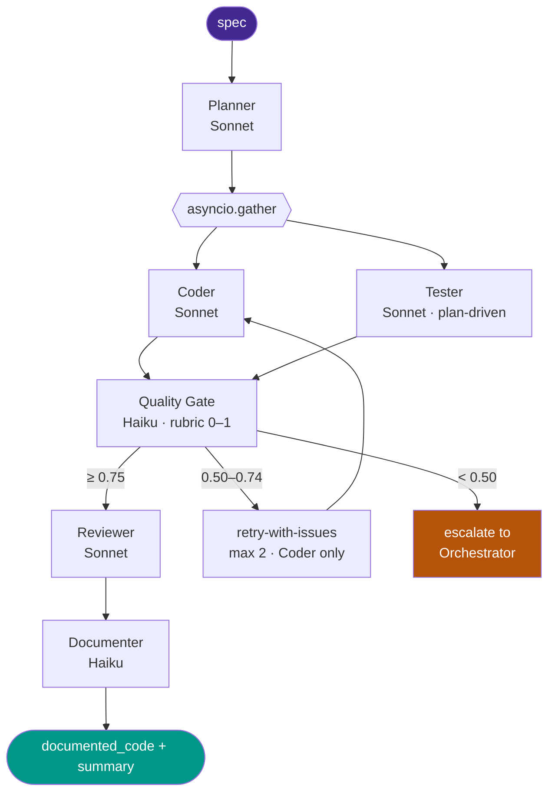

<div align="center">

<!-- ponytail: hero banner is a placeholder — drop a real 1280×320 PNG at docs/banner.png to replace this line -->


# 🛠️ CodeOrch

### Multi-Agent Code Generation Pipeline

*One natural-language spec in → working, tested, documented code out. Stateless agents over an externalized context store — the property that lets the pipeline survive 3am.*

<br/>

[](LICENSE)
[](https://www.python.org/)
[](https://www.anthropic.com/)
[](https://github.com/pgvector/pgvector)
[](https://fastapi.tiangolo.com/)
[](https://langfuse.com/)

<br/>

[**Quick Start**](#-quick-start) · [**Architecture**](#-architecture) · [**8 SLIs**](#-the-8-slis-live-on-the-dashboard) · [**RouterBench**](#-routerbench--ab-benchmark-for-the-quality-gate) · [**Known Limits**](#-scope--known-limits)

</div>

---

## 🧭 Overview

Stateless agents with an externalized context store. One natural-language spec in, working / tested / documented code out — via a planner, parallel coder + tester, an LLM-as-judge quality gate with self-correction, a reviewer, and a documenter. Multi-model routing across Opus 4.7 / Sonnet 4.6 / Haiku 4.5. Operational visibility through an 8-SLI Streamlit dashboard.

Every agent reads inputs from pgvector and writes outputs back. **No in-memory chaining.** A failure mid-pipeline writes a `status='failure'` partial-state record — the next agent sees `read_stage(run_id, ...) is None` and the orchestrator decides retry vs escalate.

---

## 🧩 Architecture



### What's inside

- **Stateless agents over an externalized context store.** Each agent reads its inputs from pgvector and writes its output back. Crash-recovery and post-mortem are queries, not log-grepping.
- **Failure isolation by construction.** `asyncio.gather(coder, tester, return_exceptions=True)` — a Coder crash doesn't take Tester down. Both partial-state rows persist for inspection.
- **Plan-driven Tester (not impl-driven).** Tester reads the spec/plan, not Coder's code, so the gate compares output against an independent reference. Eliminates the circular-validation problem.
- **Quality gate with verdict/routing consistency enforced in code.** The model can produce `score=0.92, verdict="retry"`; we override after parsing so routing stays trustworthy.
- **Self-correction loop.** Score 0.50–0.74 → re-run Coder with the gate's `issues` injected as additional context. Max 2 retries. Tester output reused.
- **Multi-model routing as a first-class concern.** `agents/models.py` is the single source of truth — every agent's model choice has a one-line rationale.
- **Production observability.** Langfuse — one trace per run, sessions, user_id, tags. Token cost auto-computes from `usage_details + model`.

---

## 🚀 Quick Start

```bash
cd codeorch

# 1. boot postgres + pgvector
docker compose up -d

# 2. install deps in a venv
python3 -m venv .venv && source .venv/bin/activate
pip install -r requirements.txt

# 3. populate .env (copy .env.example, fill keys)
cp .env.example .env   # then add ANTHROPIC_API_KEY + LANGFUSE_*

# 4. full-pipeline smoke test (8 stages)
python tests/day6_smoke.py

# 5. boot the API
uvicorn api.main:app --reload --port 8765
curl -X POST localhost:8765/generate -H 'content-type: application/json' \
  -H 'x-user-id: you@example.com' \
  -d '{"spec":"Write a Python function `clamp(x, low, high)`. Include 2 pytest tests."}'
```

<details>
<summary><b>▶ Dashboard + golden benchmark</b></summary>

```bash
# boot the SLI dashboard (separate terminal)
streamlit run dashboard/app.py
# → http://localhost:8501

# run the golden benchmark (requires the API up on port 8765)
npx promptfoo eval --config evals/promptfoo.yaml --output evals/results.json
python evals/promptfoo_runner.py    # → evals/report.html
```

</details>

---

## 📊 The 8 SLIs (live on the dashboard)

| # | SLI | Target | Notes |
|---|---|---|---|
| 1 | Agent failure rate | < 5% | per agent-stage attempt |
| 2 | Cross-agent context loss | < 2% | runs missing any of plan/code/tests/gate |
| 3a | Planner latency (avg) | < 8s | Sonnet 4.6 |
| 3b | Coder latency (avg) | < 30s | Sonnet 4.6 |
| 3c | Gate latency (avg) | < 5s | verdict-only on Haiku 4.5 |
| 4 | Task completion accuracy | ≥ 75% | gate verdict='pass' rate |
| 5 | Hallucination flags | < 10% | gate.issues populated |
| 6 | Cost per task per model | Haiku < $0.01, Sonnet < $0.05, Opus < $0.20 | from Langfuse generation spans |
| 7 | Retry rate | < 20% | runs with retries_used > 0 |
| 8 | Model routing distribution | Opus < 15%, Haiku > 40% | structurally — Haiku owns gate + documenter |

---

## 🏁 RouterBench — A/B benchmark for the quality gate

`routerbench/` ships an A/B harness that replays prior runs through three gate variants — Haiku-weighted-rubric, Haiku-verdict-only, Sonnet-verdict-only — to quantify the cost-quality trade-off in routing decisions.

Headline result on the 13-run benchmark:

| Variant | Mean score | Mean latency | Mean cost | Pass rate |
|---|---|---|---|---|
| Haiku-weighted | 0.903 | 7.4s | $0.00428 | 92% |
| **Haiku-verdict-only** | **0.915** | **1.9s** | **$0.00189** | **100%** |
| Sonnet-verdict-only | 0.940 | 4.7s | $0.00610 | 92% |

Verdict-only on Haiku won on all three axes (3.9× faster, 44% cheaper, slightly higher score). The production gate was switched to verdict-only as a result; `gate_variants.py` keeps the weighted prompt accessible for retry/escalate paths where decomposed scoring aids root-cause.

```bash
python routerbench/run_benchmark.py     # replays 13 runs × 3 variants → results.jsonl
python routerbench/generate_report.py   # renders routerbench_report.html
```

---

<details>
<summary><b>📁 Repository layout</b></summary>

```
codeorch/
├── docker-compose.yml          postgres 15 + pgvector
├── scripts/init_schema.sql     agent_context table + indexes
├── store/context_store.py      write_stage / read_stage / list_run
├── agents/
│   ├── base_agent.py           sync run() + async arun(); try/catch + partial state writer; shared _generate helper
│   ├── anthropic_client.py     sync + async call wrappers; JSON parse + token usage
│   ├── models.py               central routing table (Opus 4.7 / Sonnet 4.6 / Haiku 4.5)
│   ├── planner.py              Sonnet — spec → structured plan
│   ├── coder.py                Sonnet, async — plan → code files
│   ├── tester.py               Sonnet, async — plan → test files (NOT impl-driven)
│   ├── quality_gate.py         Haiku — verdict-only score + routing
│   ├── gate_variants.py        Haiku-weighted / Haiku-verdict / Sonnet-verdict (used by RouterBench)
│   ├── reviewer.py             Sonnet — final approval + final_code
│   ├── documenter.py           Haiku — adds docstrings; non-blocking on failure
│   └── orchestrator.py         lifecycle: planner → gather(coder,tester) → gate → retry/route → reviewer → documenter
├── observability/langfuse.py   one-trace-per-run; sessions; user_id; tags; cost auto-compute
├── api/main.py                 FastAPI: POST /generate, GET /runs/{id}, /health
├── dashboard/app.py            Streamlit 8-SLI dashboard
├── evals/
│   ├── promptfoo.yaml          10-task golden benchmark (3 easy / 4 medium / 3 hard)
│   └── promptfoo_runner.py     HTML report renderer
├── routerbench/
│   ├── run_benchmark.py        replay-based A/B runner across gate variants
│   ├── generate_report.py      plotly HTML report generator
│   └── routerbench_report.html headline result page
├── tests/                      smoke + integration tests
├── requirements.txt
└── .env.example
```

</details>

<details>
<summary><b>🧱 Stack</b></summary>

- **Language:** Python 3.11+
- **Agents:** Anthropic Claude (Opus 4.7 / Sonnet 4.6 / Haiku 4.5) via official SDK; async via `asyncio.gather` for parallel Coder + Tester.
- **Context store:** PostgreSQL + pgvector (HNSW index). Schema documented in `store/`.
- **Observability:** Langfuse (self-hosted or cloud), one trace per pipeline run with per-stage spans.
- **Evals:** Promptfoo (golden dataset, JSON-Schema assertions), in-tree A/B harness for RouterBench.
- **Dashboard:** Streamlit, 8-SLI live view from Langfuse + Postgres.
- **Dev infra:** docker-compose for Postgres + pgvector + Langfuse local stack.

</details>

---

## 🔍 Scope / Known Limits

**In scope.** Stateless multi-agent code generation pipeline over an externalized context store, with quality gating, multi-model routing, observability, and reproducible benchmarks. End-to-end working demo with verifiable SLIs.

**Known limits.**

- Single-language target (Python code generation). Multi-language would need stage-specific Tester adaptations.
- RouterBench n=13 baseline runs — small sample, results directionally robust but worth re-running at n≥50 before treating as definitive.
- No production-grade auth on the dashboard (Streamlit default). Add reverse-proxy auth before exposing publicly.
- Quality gate is LLM-as-judge; for high-stakes correctness use unit-test verification (already wired in Tester) as the primary signal and the gate as triage.
- Self-correction loop is one-shot — gate failure triggers one retry, not iterative refinement. Iterative loop is a roadmap item.

---

## 📚 Further Reading

- `DESIGN.md` — full architecture decisions with rationale.
- `ARCHITECTURE.md` — Mermaid diagrams of agent + store topology.

## License

MIT
